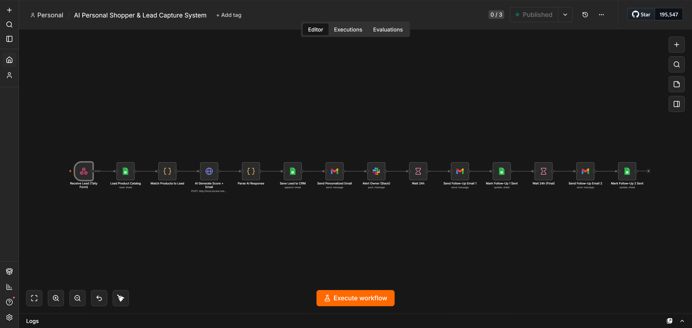
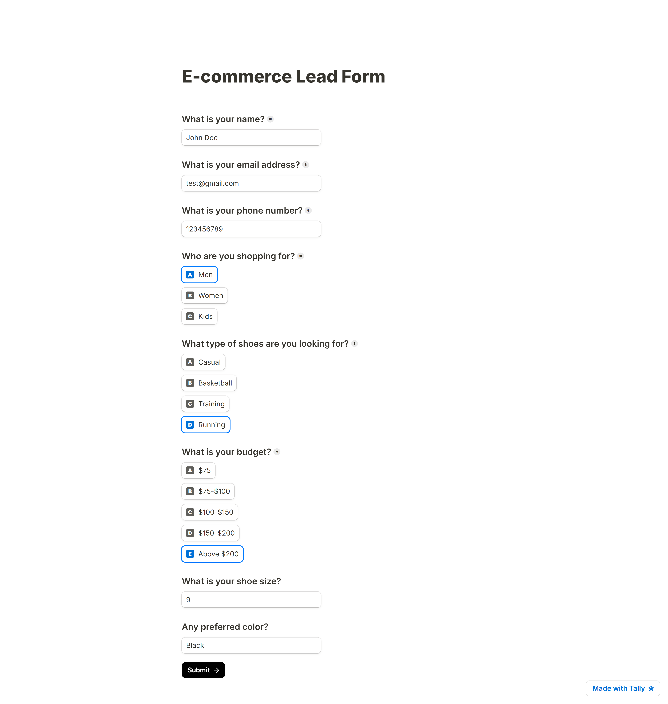
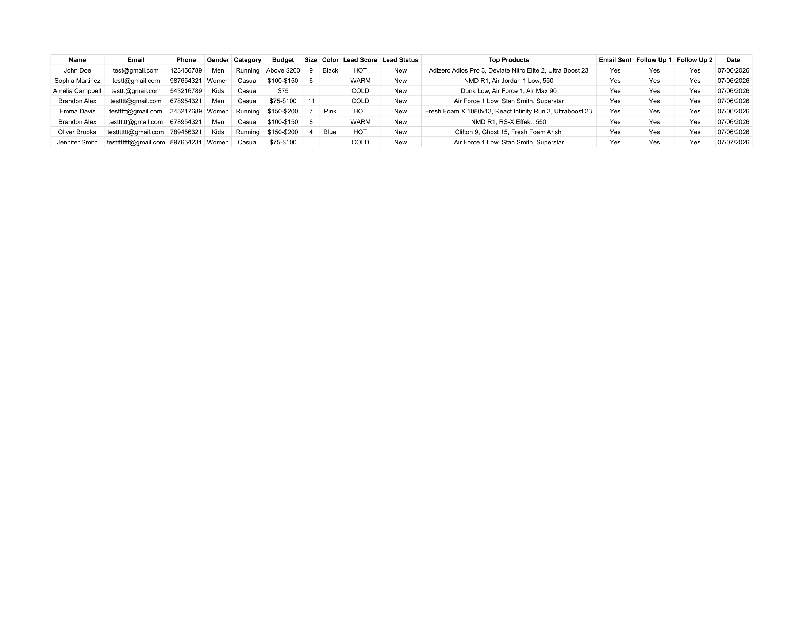
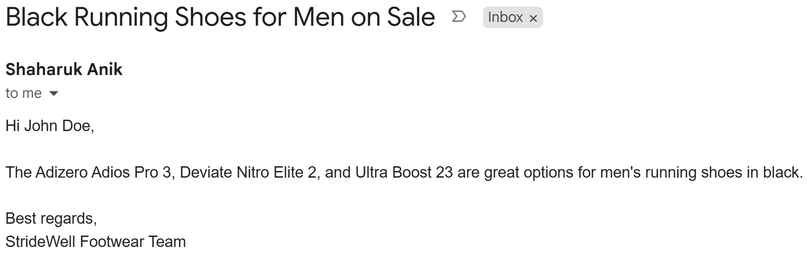
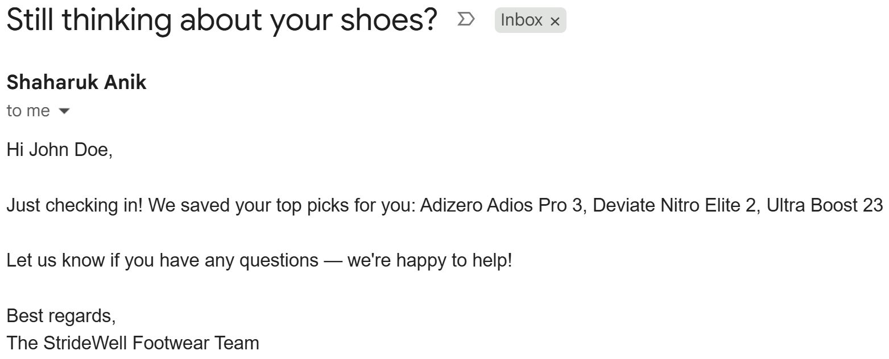
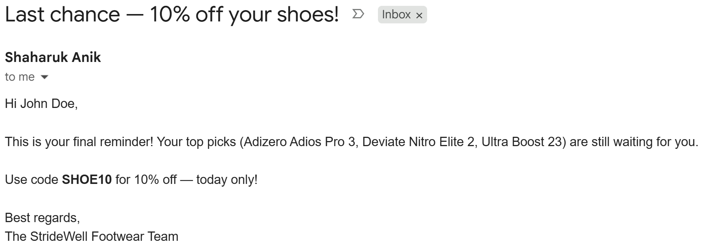
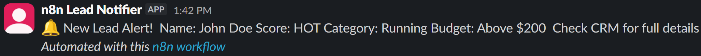
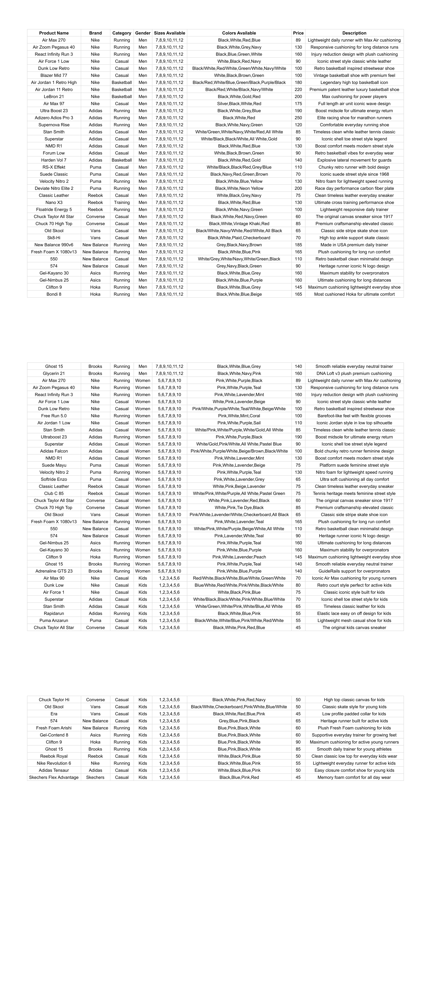

# AI Personal Shopper & Lead Capture System

> An AI-powered n8n automation that captures e-commerce leads, matches them to real inventory, scores them by intent, and follows up automatically — built for **StrideWell Footwear** (demo brand).

## The Problem

Most small e-commerce stores lose leads because follow-up is slow, generic, or forgotten entirely. A visitor fills out a form, waits hours (or never hears back), and buys from a competitor instead.

## The Solution

This workflow turns a form submission into a personalized sales interaction in under a minute, with zero manual work:

1. A lead fills out a shoe-shopping form (name, gender, category, budget, size, color)
2. The system loads the real product catalog and filters it by gender + category + **budget range**, ranking matches by closeness to the stated budget — not a random pick
3. A local LLM scores the lead (HOT / WARM / COLD) and writes a short, personalized product recommendation
4. The lead is saved to a live CRM (Google Sheets) with score, matched products, and status
5. The lead receives a personalized email instantly
6. The store owner gets a Slack alert with the lead's score and details
7. If there's no purchase within 24 hours, an automatic follow-up email goes out — then a final discount offer 24 hours after that

## Tech Stack

- **n8n** — workflow orchestration (self-hosted via Docker)
- **Tally.so** — lead capture form (webhook-based)
- **Ollama (Llama 3.2)** — local, free LLM for scoring + email generation during development
- **Google Sheets** — product catalog + CRM
- **Gmail** — personalized + follow-up emails
- **Slack** — real-time owner notifications
- **JavaScript (n8n Code nodes)** — product matching logic, budget-range scoring, AI response parsing/cleanup

> Llama 3.2 (free, local) was used for development and demo purposes. Production client deployments swap in GPT-4o or Claude for higher-quality output — the workflow architecture stays identical.

## Architecture

```
1. Receive Lead (Tally Form)
        ↓
2. Load Product Catalog        (Google Sheets — 87 products)
        ↓
3. Match Products to Lead      (Code: filters by gender + category, ranks by closeness to budget)
        ↓
4. AI Generate Score + Email   (HTTP Request → local LLM)
        ↓
5. Parse AI Response           (Code: extracts score/products/subject/body, cleans formatting)
        ↓
6. Save Lead to CRM            (Google Sheets append)
        ↓
7. Send Personalized Email     (Gmail)
        ↓
8. Alert Owner (Slack)
        ↓
9. Wait 24h
        ↓
10. Send Follow-Up Email 1
        ↓
11. Mark Follow-Up 1 Sent      (Google Sheets update)
        ↓
12. Wait 24h (Final)
        ↓
13. Send Follow-Up Email 2     (10% discount offer)
        ↓
14. Mark Follow-Up 2 Sent      (Google Sheets update)
```

## Key Features

- **Budget-aware product matching** — ranks catalog items by proximity to the customer's stated budget range, not just gender/category filtering
- **AI lead scoring** — HOT / WARM / COLD based on budget and specificity of details provided
- **Personalized, AI-generated copy** — every email is unique to the lead, not a template
- **Automated 2-step follow-up sequence** — recovers leads who don't convert immediately
- **Live CRM** — every lead, score, and matched product tracked in Google Sheets
- **Real-time owner alerts** — Slack notification the moment a lead comes in

## Screenshots

| | |
|---|---|
| **Workflow Overview**<br> | **Lead Form**<br> |
| **CRM Entry**<br> | **Personalized Email**<br> |
| **Follow-Up Email 1**<br> | **Follow-Up Email 2**<br> |
| **Slack Alert**<br> | **Product Catalog**<br> |

## Future Enhancements

- Duplicate-lead detection (skip re-processing the same email within 24h)
- Auto-skip follow-ups once a lead is marked "Converted"
- Swap Google Sheets CRM → HubSpot for larger clients
- Replace Tally with a native website-embedded form
- Dedicated error-handling workflow with Slack alerts on failure

## Live on n8n's Official Template Library

This workflow was reviewed and published to n8n's official public template library: [Score leads and send personal shopper emails with Llama 3.2, Gmail, and Sheets](https://n8n.io/workflows/17299-score-leads-and-send-personal-shopper-emails-with-llama-32-gmail-and-sheets)

## Author

**Shaharuk Anik** — AI Automation Specialist | Verified n8n Creator

[](https://www.linkedin.com/in/shaharukanik)
[](mailto:shaharukianik@gmail.com)
[](https://gorgeous-kilometer-192.notion.site/AI-Personal-Shopper-Lead-Capture-System-39e8dcd3964c8021b658d46fc6cd142a?pvs=74)
